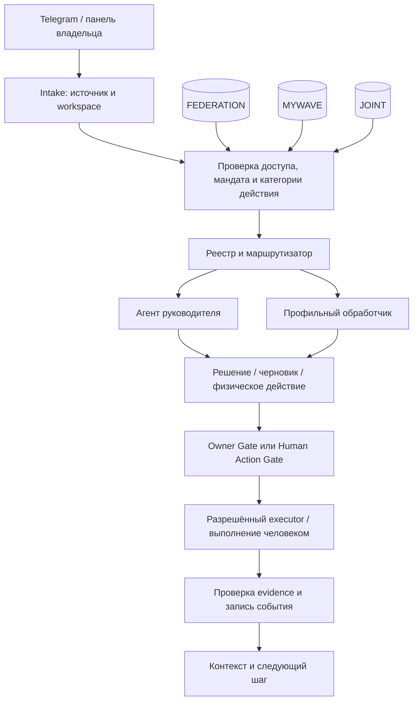

# Архитектура

## Проверенный baseline

| Текущий файл | Что уже есть | Чего это не обеспечивает |
|---|---|---|
| app/orchestrator/triage.py | domain/task_type и routing hints | подтверждённого workspace или прав доступа |
| app/orchestrator/agent_clusters.py | domain → STRATEGY/MEDIA/EVENTS/KNOWLEDGE | реестра новых профильных агентов |
| app/storage/models.py | Project, Task, Run, Decision, Approval, AuditEvent, ExecutionEvent, MemoryEntry | обязательного workspace, истории supersedes и мандата |
| app/gateway/registry.py, router.py | capabilities по scope/action | изоляции данных между Федерацией и коммерческими продуктами |
| docs/architecture/DOMAIN_MODEL.md | целевая общая модель | доказательства реализации перечисленных там всех полей |

Workspace — отдельная ось, не замена domain, project_id или gateway scope.
LLM может предложить классификацию, но не выдать полномочия или открыть данные.

Схема целевая. Сейчас универсальный gateway не следует считать проверкой
прав на каждую сущность. До реализации всех write/read guards контур выключен.

## Предлагаемые сущности

- Workspace: id, kind FEDERATION/MYWAVE/JOINT, owner, policy_version.
- WorkspaceMembership: principal, workspace, read/write capabilities, expiry.
- ScopedRecord: workspace_id, project_id, owner, classification, source_ref,
  source_date, confidence, usage_rights. Это общий контракт объектов, не новая
  физическая универсальная таблица.
- AgentDefinition: stable id, version, scopes, handlers, permissions, enabled.
- Mandate: issuer, subject, scope, evidence_ref, valid_from/to, revoked_at,
  verification_status. Обсуждаемая роль хранится отдельно как гипотеза.
- DecisionRevision: immutable id, supersedes_id, reason, source, confirmed_by,
  confirmed_at; одна текущая подтверждённая версия на предмет решения.
- PhysicalAction: task/workspace, цель, контакт, основание, срок с timezone,
  ожидаемый результат, сценарий, материалы, next_step, version, status.
- ActionReceipt: action_id, client_event_id, actor, received_at, source_ref,
  statement, evidence_status. Устное сообщение — reported, не external_verified.
- CrossWorkspaceGrant: разрешённые поля, source/destination, purpose, approver,
  expiry и hash версии передаваемого материала.

## Совместимость и границы

Миграции additive: сначала nullable workspace и карантин legacy, затем
проверенный backfill и обязательность. Старые записи не считать MYWAVE только
потому, что они существовали до Федерации. До классификации они доступны
владельцу в legacy-read-only, но исключены из retrieval и новых execution packs.
Новый scoped API требует workspace сразу. Старые клиенты не должны обходить
проверку через PATCH, поиск, exports, artifacts, memory или background runner.

JOINT не является объединённой базой: туда попадают только явно разрешённые
проекции. Каждый коммерческий продукт дополнительно изолирован project_id и
capability: общий MYWAVE не открывает клиентские базы соседнего продукта.
Фильтрация нужна до retrieval/ranking и при выдаче файлов, а не только в UI.
Workspace и права передаются в run, handoff, cache key и execution pack.

Изменения статусов и decision revisions пишутся с AuditEvent в одной транзакции.
Одна текущая версия решения обеспечивается DB constraint/transaction, история
не удаляется. Повтор receipt с тем же client_event_id не повторяет side effects.
Физическое действие не исполняется code runner; подтверждение подготовки не
равно подтверждению физического выполнения.

Код живёт в текущем app/SoT, без нового VPS или отдельной БД по умолчанию.
Infra и Compose, если потребуются, оформляются отдельным PR после измерения.
